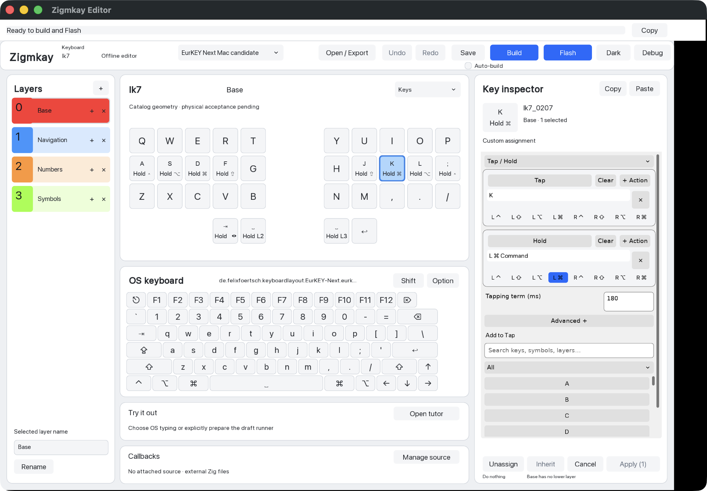
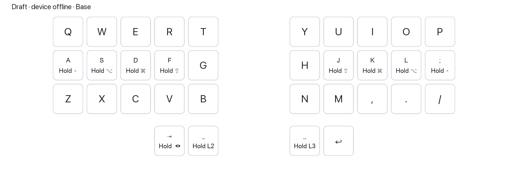
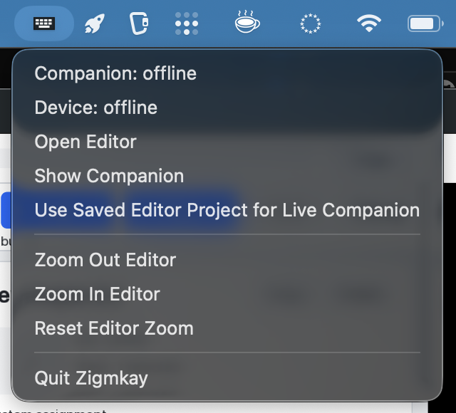

<div align="center">

# Zigmkay Companion

**Make your keyboard yours. Learn it as you go.**

A native visual editor, an on-demand keyboard companion, and a typing tutor
for programmable keyboards running [Zigmkay firmware](https://github.com/EuroZig/zigmkay_firmware).
Written in Zig.

[Get started](#get-started-with-mise) · [Companion](#your-layout-one-hotkey-away) · [Editor](#program-your-keyboard-visually) · [Tutor](#learn-your-layout-with-the-typing-tutor) · [Development](#development)

</div>



Choose what a key does when tapped or held, see the layout while you work,
and practice the keys that need attention. The editor and companion share a
resident desktop application, accessible from its little keyboard tray icon.

*All images below are real native macOS application captures. The companion
is shown offline; tutor exercises and history use deterministic sample data.
[Capture details](docs/screenshots/overview/README.md).*

## Get started with mise

The current way to install and run Zigmkay is from source with
[mise](https://mise.jdx.dev/getting-started). Downloadable executables are planned
for the future. Native macOS captures are available here; Windows and Linux
desktop acceptance is still in progress. See [compatibility status](compatibility/README.md).

Install [mise](https://mise.jdx.dev/installing-mise.html) and Git, then:

```sh
git clone https://github.com/conlorz/zigmkay_companion.git
cd zigmkay_companion
mise trust
mise install
mise exec -- zig version    # must print 0.17.0
mise run editor
```

Mise selects exactly **Zig 0.17.0** and prepares the pinned GUI dependencies.
The first launch may take longer while packages download and compile. A separate
firmware checkout is unnecessary; firmware sources are pinned in this repository.
On macOS, native source builds also need the Xcode Command Line Tools
(`xcode-select --install`).

For the companion in the background, start this instead:

```sh
mise run companion
```

It starts with its windows hidden. Use the tray icon to open the editor or show
the companion. Normal startup automatically monitors compatible keyboards.
Firmware transfer starts only when you explicitly choose **Flash**.

## Your layout, one hotkey away

Forgot where a symbol lives? Bring up a transparent, passive overlay of your
keyboard. With a verified connection, it follows the running profile's layers,
modifiers and pressed keys. It stays out of pointer interaction so you can keep
working in your current application.

<picture>
  <source media="(prefers-color-scheme: dark)" srcset="docs/screenshots/overview/companion-dark.png">
  
</picture>

Program a key's tap or hold action as **Show / hide companion** (reserved signal
`255`). In the default mode, a quick tap toggles the overlay; a longer press
shows it while held and restores its previous visibility on release. Dedicated
hold-only and toggle-only modes are available for development and testing.

The overlay uses the verified running layout. Losing the connection clears its
visibility; editor changes remain a draft until built and flashed. The screenshot
above shows the explicitly labeled offline draft view.

## Program your keyboard visually

The physical keyboard, layer list, OS keyboard palette and key inspector live
in one window. Select a key, search for an action, or drag an OS keyboard chord
into the inspector. Apply edits explicitly, with undo/redo available afterward.

- **Tap, hold, tap/hold and repeat:** tune tapping terms and repeat delays;
  combine key chords with left/right modifiers.
- **Layers and one-shots:** add, duplicate and name layers, use layer holds,
  and distinguish inherited assignments from keys that do nothing.
- **More than letters:** assign media controls, mouse actions, companion signals,
  combos and encoder actions.
- **Your own Zig:** preserve callback source snapshots, attach external source,
  and refresh it explicitly when it changes.
- **Projects and profiles:** save and reopen projects, switch profiles, and
  export source for firmware builds. The catalog contains 14 board entries;
  individual hardware acceptance is tracked separately.

### Build and Flash from the same window

**Build**, **Flash** and optional **Auto-build** sit in the editor toolbar shown
above. Normal source startup prepares the build environment and Flash tools in
the background, with status in the system-message bar and **Retry setup** if
preparation fails.

Click **Flash** to build the current project if needed, request BOOTSEL, transfer
the verified UF2, and wait for reconnection. If BOOTSEL is not discovered, the
editor prompts for manual entry. Progress stays in the message bar; errors open
details. Auto-build compiles edits without starting a transfer.

Source builds currently need their compiler and checkout to remain available.
[Build and Flash details](docs/development.md#editor-build-and-flash) explain
preparation, supported source bindings and current limits.

## A little tray icon, always within reach

Close the editor window and keep the resident application available. The tray
menu opens the editor, shows or hides the companion, reports device status,
adjusts editor zoom, and lets you explicitly bind a saved editor project to the
live companion. **Quit Zigmkay** exits the resident application.

<p align="center">
  
</p>

## Learn your layout with the typing tutor

Choose **Open tutor** in the editor. Practice fresh English text with Words,
Mixed case or Punctuation presets, or use a retained Zig lesson. Choose length
and assistance independently; reproducible challenge seeds let you share an
exercise with a friend.


### Learn a few keys, then build up

Six guided stages take you from **Find keys** and **Build fluency** through
**Shift**, **Layers**, **Modifiers** and **Real text**. Start with a small
reachable alphabet and readable words, then add one letter or key family at
a time. Suggestions use matching practice history; you choose when to advance.
Saved lesson context can be resumed later.


### Get help when you need it

Use full guidance, delayed hints, hints on request, a layout-only reference,
or hidden assistance. Cyan marks keys to **hold** and amber marks the key to
**tap**. Delayed hints can adapt to your clean character timing. Optional recall
review suggests familiar targets to revisit with help hidden.

<details>
<summary>See hint guidance and recall review</summary>


</details>

### Turn mistakes into the next exercise

Each completed run separates speed, attempt accuracy and first-pass success.
Layer and modifier heatmaps show missed characters alongside practice exposure.
Compare this run, the last ten matching runs or all matching history, inspect
confusions, and start fresh weak-spot drills from the result.


### See progress and understand hesitation

Track speed and accuracy trends, character progress, daily activity and voluntary
practice goals. Dive into character medians, slow-tail timing, transitions,
run rhythm and individual recorded events. Comparisons keep different layouts,
input sources and assistance settings separate.


<details>
<summary>See daily activity, character timing and run rhythm</summary>


</details>

### Keep your practice history

History is stored locally in SQLite. Export a standalone practice database and
merge it on another computer; saved curriculum context travels with it. Practice
data tools include migration, transfer previews and history management.

<details>
<summary>See practice data and transfer tools</summary>


</details>

The [typing practice guide](docs/typing-practice.md) covers controls, metrics,
storage and evidence rules. Text input measures output and timing; it cannot
prove which finger or physical route you used. Lesson and recall suggestions
are initial policies for manual validation.

## Development

Use this checkout and the pinned compiler; no private plans or sibling
repositories are required. Start with the offline checks:

```sh
mise run check
mise run test
```

The [development guide](docs/development.md) covers the package map, native GUI
builds, explicit offline startup, test tasks, dependency preparation and further
design/implementation docs. Builds, tests and explicit offline startup do not
access keyboards. See [compatibility status](compatibility/README.md) for the
remaining platform and hardware acceptance work.

## License

Zigmkay companion is free software under the **GNU General Public License,
version 2**. See [LICENSE](LICENSE). Imported dependencies retain their own
license notices.
