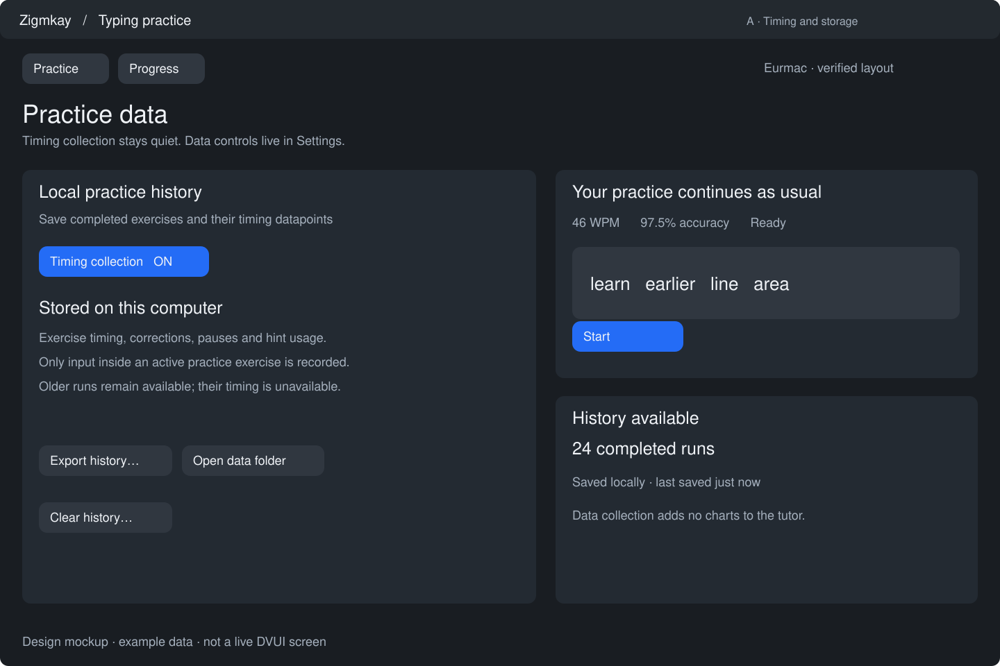
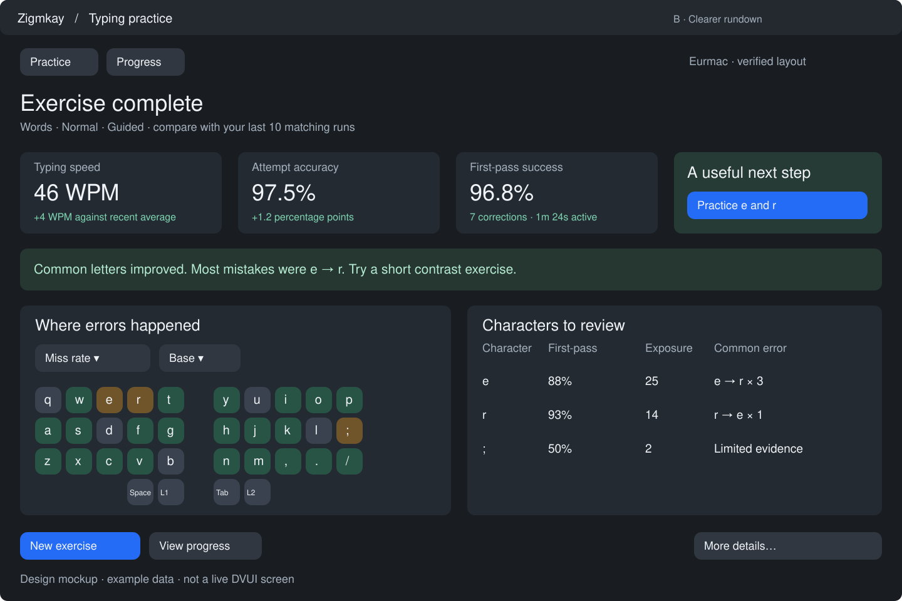
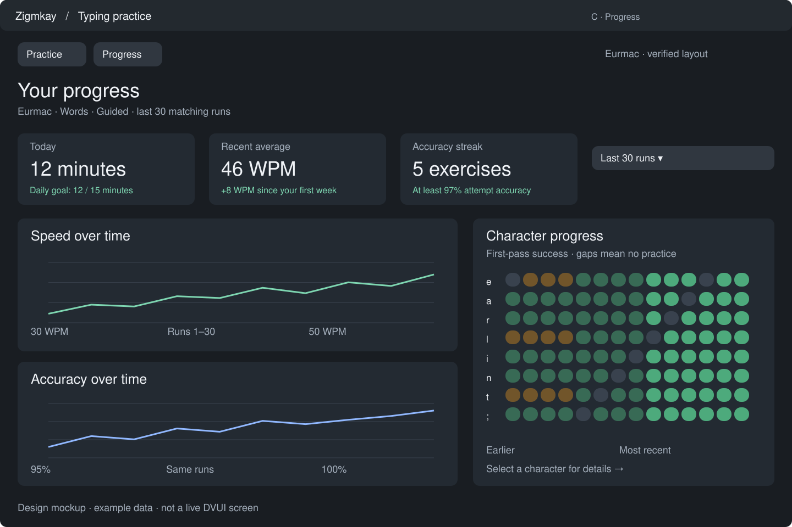
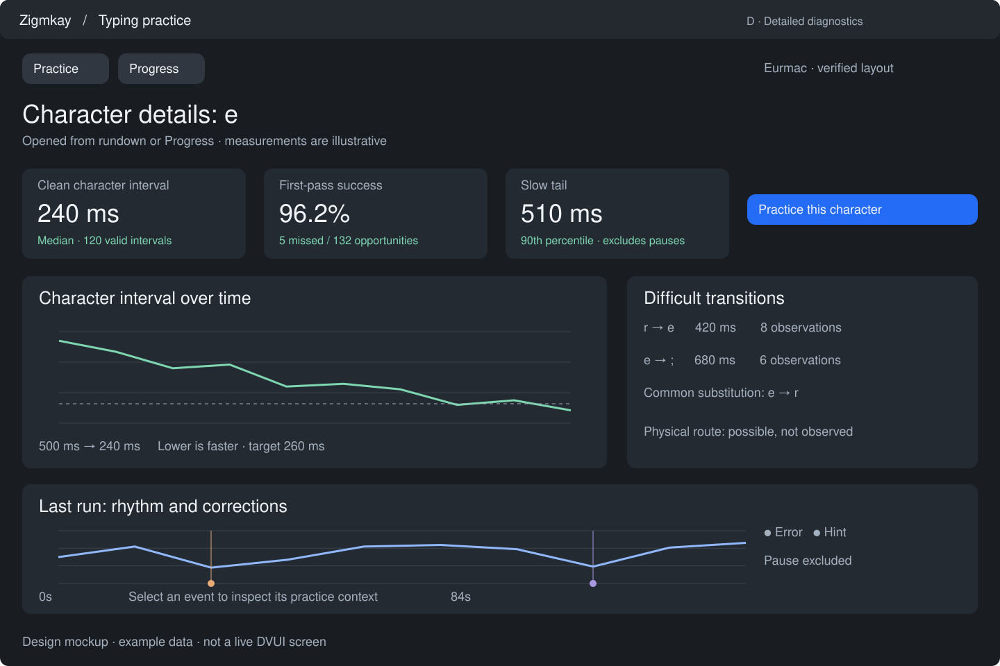
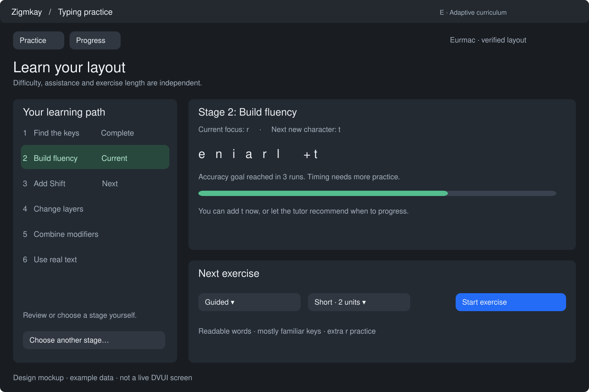
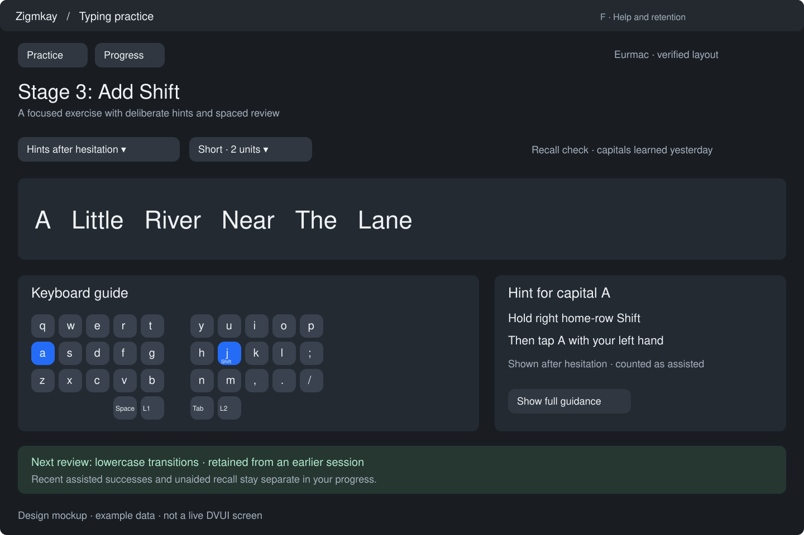
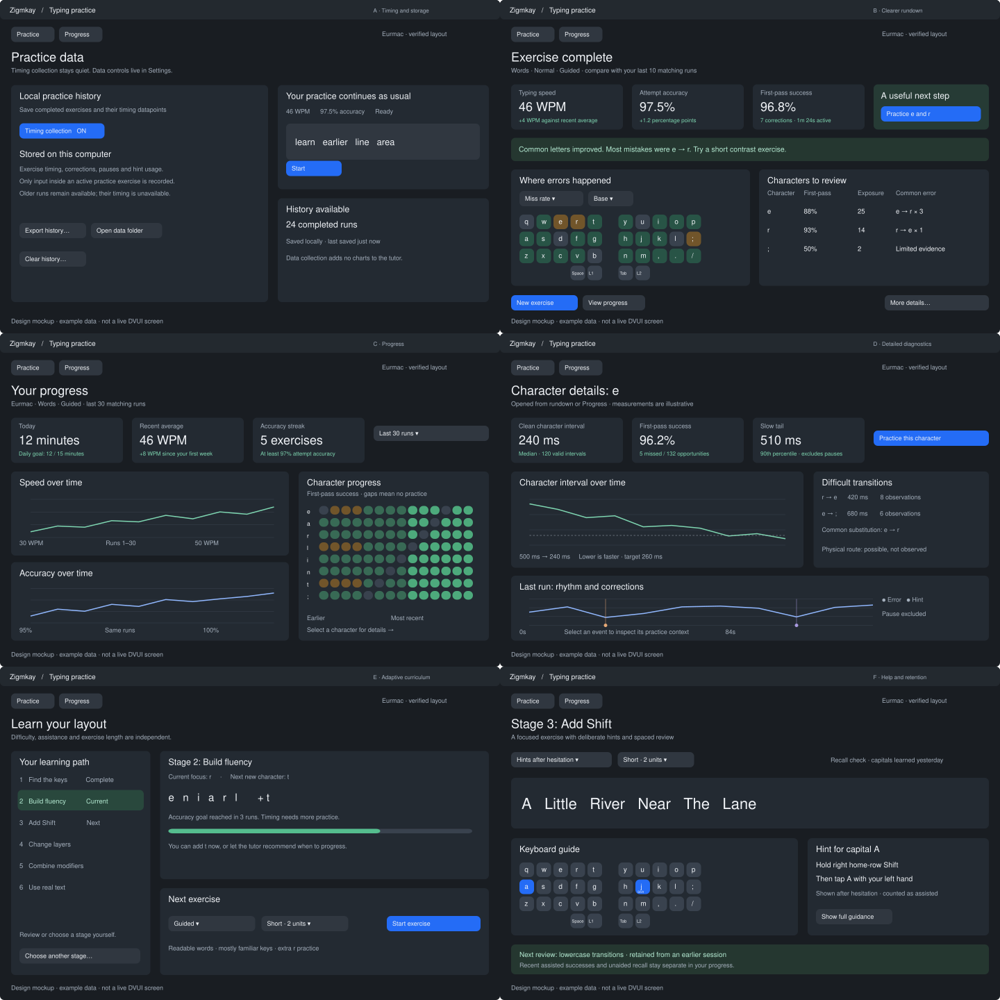

# Typing practice: timing, implementation packages and UI studies

Date: 2026-10-14. Packages A–E are implemented in PR #2; F remains the design and tracking sequence. The mockups use illustrative data and are not native DVUI screenshots. See [package A implementation evidence](../implementation/practice-data.md), [package B review](../implementation/practice-rundown.md), [package C review](../implementation/practice-progress.md), [package D review](../implementation/practice-diagnostics.md), [package E review](../implementation/practice-curriculum.md) and the tutor documentation for current behavior.

## Current storage and the database gap

There is no database engine in PR #2. Completed exercises are saved as version-1 ZON files, one immutable random-ID filename per run, under:

- macOS: `~/Library/Application Support/zigmkay/data/typing-practice/`
- Windows: `%LOCALAPPDATA%/zigmkay/data/typing-practice/`
- Linux: `$XDG_DATA_HOME/zigmkay/typing-practice/`, falling back to `~/.local/share/zigmkay/typing-practice/`

The implementation serializes bounded records, synchronizes the temporary file, and publishes it atomically with exclusive linking. Repeated writes of the same ID/content are idempotent. Different application instances publish different files. A background worker performs writes and queries. Queries scan files, filter exact cohorts, rebuild weighted aggregates and return ten-run pages. Corrupt and unknown-version records are retained and reported. The current maximum serialized record size is 512 KiB.

See [history implementation](../../packages/desktop/src/practice_history.zig), [background persistence](../../packages/desktop/src/practice_history_runtime.zig), and [record schema](../../packages/desktop/src/practice_results.zig). The previously discussed user-directory DB is not implemented. The file approach supplies durable history, but increasingly rich chronological queries and event volumes warrant an indexed store.

Current records retain timestamps, active duration, attempts, correct attempts, corrections, per-character opportunities/misses/retries, substitutions, possible routes and comparison context. They do not retain individual timing samples. Whole-run duration cannot reconstruct them.

## Package A: occurrence timing and durable data

This package is the first priority and introduces no graphs to practice or rundown. Its settings mockup illustrates local data controls, not a mandatory new step in the practice flow.

### A1: collect datapoints now

Persist an append-only exercise event sequence, plus its frozen run context. Events should include:

| Field | Purpose |
|---|---|
| Run ID, event ordinal, schema/metric version | Stable identity and replay order |
| Monotonic elapsed microseconds and active microseconds | Recompute intervals; distinguish explicit inactivity |
| Event kind | Insert attempt, correction/backspace, pause, resume, focus change, hint shown/requested, stop/complete |
| Reference position and expected Unicode scalar | Associate retries with the intended occurrence |
| Attempted Unicode scalar, where applicable | Recompute confusion/correction metrics inside the exercise |
| Commit/batch ID and input classification | Detect paste, IME/multi-scalar commits and repeats |
| Timing eligibility/exclusion reason | Keep observations while excluding unsuitable intervals from motor-speed estimates |
| Hint exposure and assistance state | Separate assisted practice from unaided recall |
| Observed route and correlation quality, if available | Future physical coaching; unavailable is distinct from inferred |

Store the generated exercise reference, seed, generation version and frozen source/layout identity. Add future curriculum fields with explicit unavailable/default states. The reference and event positions allow future word and transition analysis even after the generator changes. Capture only the active exercise input, never background typing.

Timing semantics: the initial input starts the timing anchor and has no preceding motor interval. Pause/resume, focus loss, source/layout changes and batched commits reset or invalidate the anchor. The first input after such a boundary is not a clean ordinary interval. Retain correction attempts individually. Preserve genuine long hesitation; analyses can distinguish it from explicit pause without deleting datapoints. OS text timing measures delivered character input, not physical switch actuation or finger movement.

Use an owned event buffer frozen on completion and transferred to persistence without copying it every frame. Establish a tested memory/event limit; set a persisted truncation boundary when it is reached. A candidate starting bound is 32,768 events per run, to be measured against actual memory and serialization costs. Keep existing count statistics usable after timing truncation. Do not silently retain only aggregates or downsample canonical events.

Version-1 files continue to load with timing explicitly unavailable. Version-2 serialization limits must be revised for event payloads rather than forcing events into today's 512 KiB envelope. Stopped/incomplete runs need explicit status and exclusion from completed-run comparisons. Publish completion once per run. No filesystem/database operation belongs in the keystroke loop.

Deliver A1 independently if DB integration takes longer: version-2 immutable run files can preserve the event sequence immediately.

### A2: user-directory database

Proposed eventual path: `…/typing-practice/practice.sqlite3`. SQLite is a recommendation, not a new dependency added by this design task. Use one persistence worker, transactions for a run plus events, uniqueness on run ID and `(run_id, ordinal)`, and indexed chronological/cohort queries. Use short reader transactions and a bounded busy/retry policy. WAL permits concurrent readers with a writer but still allows only one writer and requires accompanying WAL/checkpoint handling. See [SQLite WAL documentation](https://www.sqlite.org/wal.html).

Suggested logical tables: `runs`, `exercise_events`, derived `character_summaries`, `curriculum_state`, and a schema/migration table. Derived summaries are rebuildable from events and versioned by analysis policy. Keep the full comparison identity alongside any index hash. Explicitly declare the wall-clock timestamp unit and metric definitions.

Import both old count-only runs and new event-bearing files idempotently. Verify per-run counts, IDs and event sequence before marking each import complete. Import interruption or unreadable records must not erase the source files. Preserve originals until a deliberate later cleanup. After verified cutover, the DB becomes the authoritative destination for new runs; do not operate an indefinite uncoordinated dual-write system. Provide a consistent backup/export operation that includes the database's actual committed state.

The user approved the narrow SQLite C API bridge exception on 2026-10-14. SQLite 3.54.0 is pinned to verified source; all application logic remains Zig. A1/A2 are delivered together in this PR with raw-event capture, transactional database storage, preserved legacy records and portable export/import.

Acceptance: exact timing with injected clocks; corrected errors; pause/resume; focus loss; Unicode and batched input; repeat classification; explicit truncation; interrupted writes/imports; old history; duplicate saves; simultaneous app writers; database busy/retry; no device access in tests.



## Package B: a clearer, compact rundown

Research items 1, 2, 4, 5 and 6: coaching summary, sortable character details, heatmap modes, visible sample reliability and confusion pairs.

Show large primary metrics, a one-sentence observation, and one recommended next exercise. Keep first-pass occurrence success and attempt accuracy distinctly named. Compare only equivalent cohorts and show an empty baseline when there is too little history. The keyboard and table share selection. Heatmap modes explain their units; limited evidence is marked, not presented as mastery. Character substitutions open a contrast drill with a visible reason.

This package can ship using existing count records. Timing columns remain unavailable until A. Detailed confusion matrices and reliability intervals belong behind More details. In small windows, stack keyboard/table and keep the recommendation and New exercise reachable. Use real saved layout geometry, not an assumed standard keyboard.

Acceptance: weighted denominators; backspace cannot erase misses; no-data/low-evidence states; matching selection; modifier/layer variants; smaller native windows; accessible keyboard navigation.



## Package C: a separate Progress view

Research items 3, 7 and 17: chronological trends, character-by-run matrix, daily goal/calendar and accuracy streaks. The mockup shows the default Trends tab. Daily activity/calendar belongs in its Activity tab, not another chart appended to rundown.

Keep speed and accuracy in aligned separate plots with a shared run/time filter. Allow raw points and optional smoothing, preserving visible missing samples. Annotate curriculum stage or assistance changes; never compare them silently. The character matrix toggles success, exposure and, after A, timing. Selecting a run opens its rundown; selecting a character opens D.

Today/last week/all-time ranges and exact-cohort filters are first-class. Daily boundaries use an explicit timezone policy. Streak definitions state their accuracy threshold, completion requirement and eligible exercise set. Daily minutes use active practice, not time the window was open. Chart aggregation must handle large history without loading all raw events onto the UI thread.

Dependencies: chronological query API; B's run navigation. Existing counts support the first version; A adds timing mode.



## Package D: timing and skill diagnostics

Research items 8, 9, 10, 11 and 18: selected-character trends, accurate-but-slow detection, run rhythm, transitions, and modifier/layer skill summaries.

Open only on demand from a selected character or More details. Show median and slow-tail interval, valid sample count, first-pass success, a personal target, and a context-preserving drill. Run rhythm has error, correction, pause and hint markers. Transitions can reveal a difficulty hidden by per-character averages. Layer/modifier breakdowns live in a separate Skills tab.

Character intervals and physical route telemetry remain separate. Possible routes do not establish observed key/finger/Shift choices. Native/draft correlations must account for dropped/stale reports before supporting physical claims. Keep events excluded from motor speed available for contextual diagnosis. A timing histogram should describe whether it shows clean intervals, correction delays or all delivered input.

Dependencies: A, chronological queries, B/C drill navigation. Acceptance includes enough observations before ranking pairs, retained correction context, old runs with unavailable timing, and charts that reveal incomplete timelines.



## Package E: adaptive curriculum and difficulty

Research items 12, 13 and 15: progressive alphabet, six content stages, repeatable mastery. Keep assistance and length independent from difficulty.

1. Find the keys: a small useful base-layer alphabet and space; no initial speed gate.
2. Build fluency: lowercase words and transitions; introduce one character at a time.
3. Add Shift: capitals and shifted punctuation with proven compatible providers.
4. Change layers: one reachable layer mechanism at a time.
5. Combine modifiers: teach Option/AltGr and modifier/layer families separately.
6. Use real text: sentences, paired punctuation and code-specific practice.

A lesson card explains its focus and what remains before suggested advancement. Recommendations use speed, accuracy and sufficient repeated evidence. They do not lock out manual selection. Stage 1 may rely primarily on success/exposure; speed becomes meaningful after calibration. Hysteresis prevents one poor run from undoing progress. Guided success is not automatically unaided mastery.

Dependencies: A and versioned generator/curriculum state. A representative initial policy of 20 opportunities across three completed runs and 97% first-pass success is a hypothesis for human validation, not a validated learning threshold. Content must be readable and reachable for the actual layout.



## Package F: deliberate help and retention

Research items 14 and 16: hint fading and scheduled recall/review. Always available help stays a user choice.

Provide full guidance, hints after hesitation, hints on request, and hidden guide. Hints can teach a verified sequence such as hold compatible Shift, tap the target, release. The mockup shows a hint that has appeared after hesitation; the panel is absent until needed. Prefer opposite-hand home-row Shift only where metadata and routes support it.

Measure cue exposure. Maintain assisted and unaided histories separately. Mix new/weak targets with retained familiar text and later recall checks. Explain why a learned character reappears. A review queue is optional navigation, not a demand to complete a fixed schedule. Personal goals and reasonable break behavior remain learner controlled.

Dependencies: A event capture and E curriculum policy. Acceptance: cues neither alter text correctness nor disappear permanently; delayed hints exclude explicit pauses; hint thresholds are adaptive/user configurable; review recommendations do not mislabel poor evidence as forgetting.



## DVUI graph capability in our pinned dependency

Verified against pinned DVUI `9b372ab0e3beca5060eb1f9ffe3e83ee61665e37`, including its immutable prepared source. No dependency upgrade is required for the following primitives.

| Requirement | Existing support | Application work |
|---|---|---|
| Line trends | `dvui.plotXY`, `dvui.plot`, `plot.line().point/stroke` | Data queries, gaps, smoothing and series labels |
| Histograms | `plot.bar` | Binning and normalized units |
| Axes | Linear/log scales, bounds, labels, auto/custom ticks, formatting, grid/subgrid | Date/duration formatters and stable ranges |
| Hover | Point proximity/bar hit detection and numeric hover label | Run identity, units, richer context, keyboard selection |
| Multiple series | Multiple lines within one plot | Legend/toggles; separate panels for different units |
| Image export | `dvui.Picture`, PNG/JPG in examples | Export action and chart-specific captions |
| Matrix/calendar/key heatmap | Drawing paths/rectangles and existing UI widgets | Cell layout, scales, hit testing and accessibility |
| Zoom/pan/brush | No built-in behavior found in this pinned PlotWidget | Range controls or explicit event handling |
| Statistics | Not a plotting responsibility | Quantiles, uncertainty, outliers and analysis versions |

Sources: [PlotWidget](https://github.com/david-vanderson/dvui/blob/9b372ab0e3beca5060eb1f9ffe3e83ee61665e37/src/widgets/PlotWidget.zig), [plot examples](https://github.com/david-vanderson/dvui/blob/9b372ab0e3beca5060eb1f9ffe3e83ee61665e37/src/Examples/plots.zig), [plotXY API](https://github.com/david-vanderson/dvui/blob/9b372ab0e3beca5060eb1f9ffe3e83ee61665e37/src/dvui.zig#L5616).

Implement reusable chart wrappers in Zig. Prefer aligned plots over dual axes. Preserve missing-data gaps by drawing separate segments; do not interpolate silently. Use explicit ranges for singleton/empty data, independent selection state, and bounded rendering/downsampling while preserving canonical samples. DVUI's default hover reports coordinates, not domain-specific run/character meaning.

## Sequence and deliverables

Start A1 immediately as the smallest data-collection change. B can follow using existing counts. Deliver A2 after the database integration decision; C then gets efficient long-history queries. D needs A's event semantics. E can introduce basic calibrated stages after A; F adds measured help/retention after E. Each package includes its own schema/query/UI contracts and relevant offline tests; native UI validation is required where visible behavior changes.

All 18 investigated recommendations are assigned above. The mockups depict future package outcomes, so their values are examples, not measurements or claims about the current app. Package A's minimum delivery has no additional UI; its illustrated data settings can ship with A2.

Regenerate the six vector mockups and overview with exactly Zig 0.17.0:

```sh
mise exec -- zig run tools/practice_ui_mockups.zig -- docs/design/typing-practice
```


