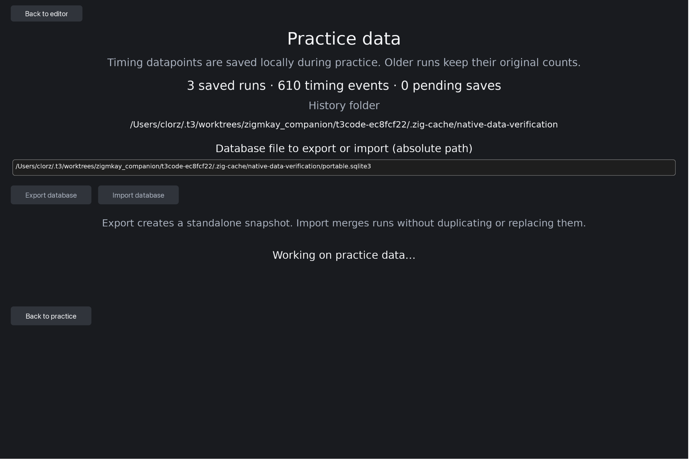
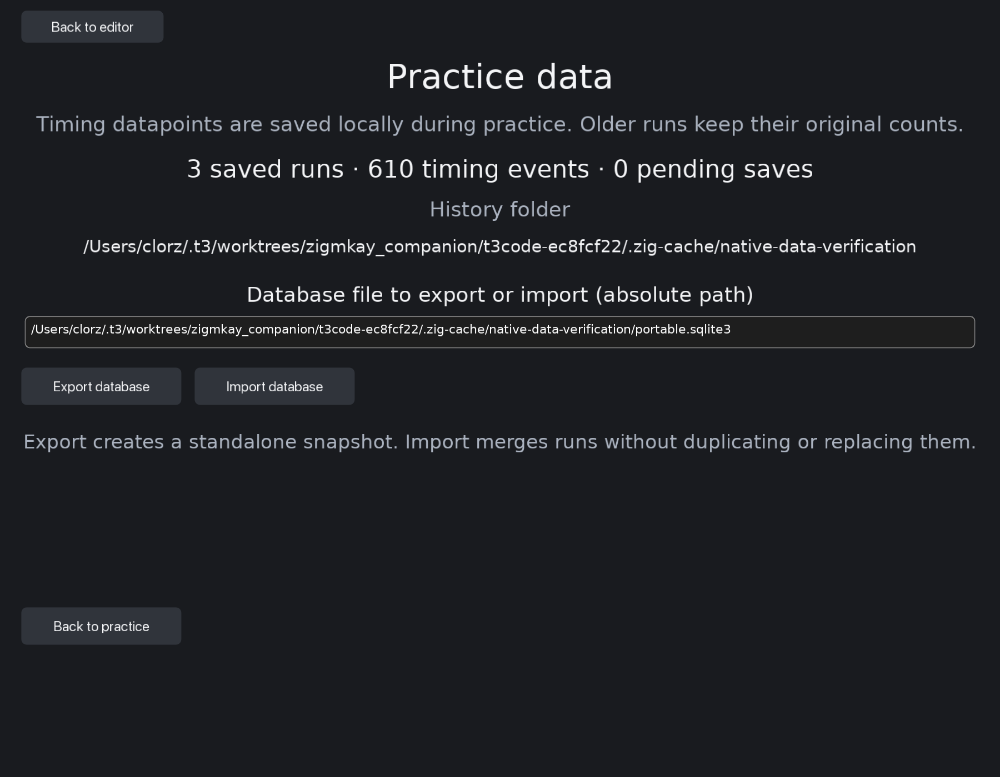

# Package A: exercise timing and portable history

Package A adds the raw data foundation without introducing charts into practice.
The user approved the narrow SQLite C API bridge exception on 2026-10-14. All
first-party capture, persistence, validation, import/export and UI logic is Zig.

## Storage and compatibility

- SQLite 3.54.0 source: `https://www.sqlite.org/2026/sqlite-autoconf-3540000.tar.gz`.
- Official archive SHA3-256, verified locally:
  `f5e3e724e9c9b3b5d512c76b02082091a59eeea9becd169a9fbf4d376403acce`.
- Immutable Zig package hash is recorded in `build.zig.zon`. The dependency
  strips the archive's `sqlite-autoconf-3540000` root directory. Clean CI
  fetching verifies the same package hash on macOS, Linux and Windows.
- Database application ID `0x5a4d5052`; package A introduced schema version 1,
  and package E upgrades it transactionally to version 2 with a practice-scope
  index. Old raw record bytes remain unchanged. Counts record version 1
  retains backward-compatible default fields; raw timing payload version 1 is
  independent of existing metric/cohort versions.
- `runs` contains frozen summary/reference-event payloads, with chronological
  and exact-cohort indexes. `events` provides derived individual timing rows.
  `legacy_imports` preserves migration receipts through deliberate clearing.
- Legacy ZON files remain unchanged. Matching import is idempotent; collisions
  and malformed/future sources preserve original data. All-or-nothing database
  imports roll back earlier rows if a later row fails.
- Export uses SQLite's backup API, streams the standalone snapshot to an atomic
  file, synchronizes it and publishes exclusively. Existing destinations are
  preserved. Snapshot busy retries have a deadline.

## Capture and ownership

The recorder retains exercise-only Unicode attempts, correction and boundary
events, original observed time, normalized elapsed/active times, input batch and
clock provenance, assistance and clean-interval eligibility. It also retains
the exact generated reference. Native SDL timestamps are forwarded alongside
the corresponding DVUI event numbers. Draft/frame fallback timestamps are
explicitly marked. No physical route is inferred from delivered text.

The session owns a borrowed recorder; its event memory lives on the heap. The
save queue clones frozen reference/events, and worker requests own independent
copies. Failed saves retain queue ownership. First truncation retains a prefix
and counts later dropped events. Stopped runs are unscored and use only observed
reference opportunities. Existing score denominators remain unchanged.

Review corrections included preserving clean timing anchors across displayed
hints, forwarding focus-loss runner effects, stopping draft input while editing
the data path, freeing SQLite backup handles exactly once, and guarding import
against summary/timing count mismatches.

## Validation

Native macOS Zig 0.17.0 checks and tests cover raw timing, Unicode/CRLF,
corrections, pause/resume, clock regression, batches, truncation, queue freezing,
legacy migration/restart/clear, standalone export/reopen/import, duplicate IDs,
conflict rollback, future schemas, concurrent writers and read-only handles.
The CI practice job now runs the same native SQLite contracts on macOS, Linux
and Windows using a data-only build graph without firmware/device access.

Native GUI build and existing offline launch/practice/rundown/companion/source
fixtures pass. The explicit `--native-data-frames` rendering mode uses cache-only
data and no HID. Its native data screen is visually compared with package A's
mockup in wide and small windows; these captures are verification evidence,
not screenshot assertions or new integration tests. Human keyboard acceptance
is left for the user's return. Further live device activity was not initiated.

The tracking plan for A is removed after delivery; plans B–F retain their
mockups until their respective stages are implemented and reviewed.
