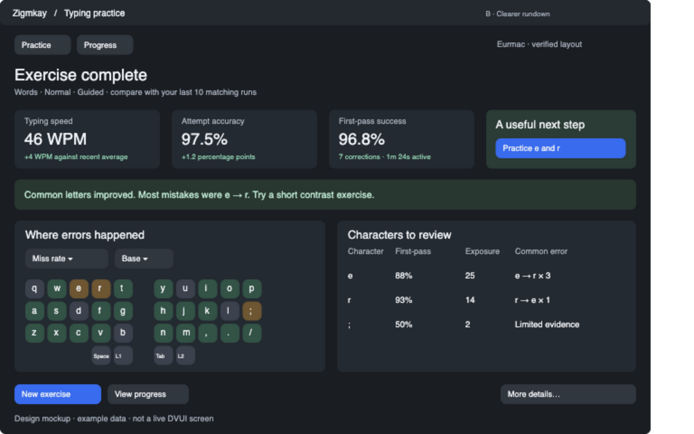

# B — Clearer compact rundown

Temporary tracking plan. Remove after implementation and review.

Implement research items 1, 2, 4, 5 and 6 together: coaching summary, one next-exercise recommendation, sortable character details, linked heatmap modes, confusion pairs and sample reliability. Keep attempt accuracy separate from occurrence success. Use exact comparison cohorts and explicit low-evidence/no-baseline states. Put advanced details behind navigation rather than adding charts to the rundown.

- [ ] Summary and recommendation
- [ ] Linked table/heatmap selection and modes
- [ ] Confusion drills and sample reliability
- [ ] Small-window and keyboard-navigation acceptance
- [ ] Metric/cohort checks and final review

Can use existing count-only history; timing columns require A. See [design](../design/typing-practice-packages.md#package-b-a-clearer-compact-rundown).
