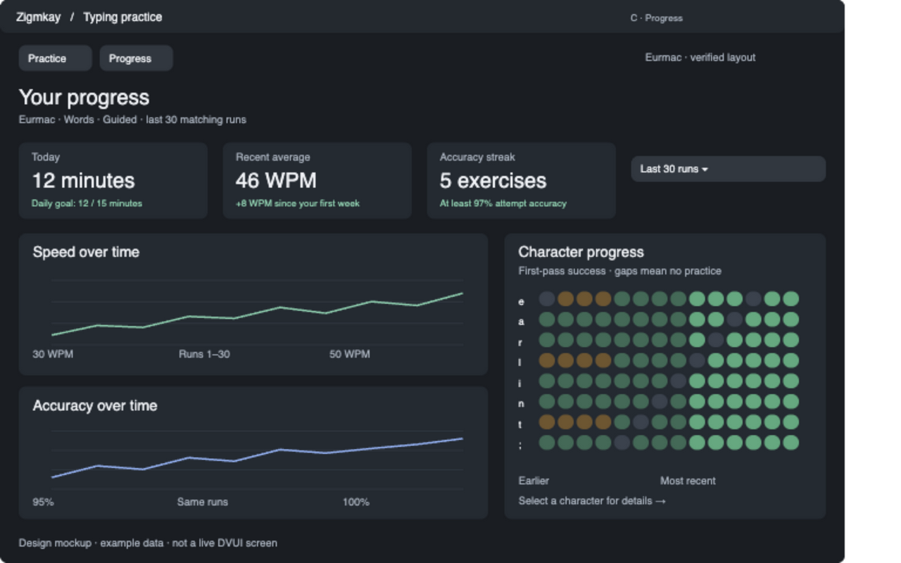

# C — Separate Progress view

Temporary tracking plan. Remove after implementation and review.

Implement research items 3, 7 and 17 together: chronological speed/accuracy, character-by-run matrix, daily goals/calendar and accuracy streaks. Keep trends out of the immediate rundown. Use raw points plus optional smoothing, visible gaps, explicit date/cohort ranges and curriculum annotations. Open B for a selected run and D for a selected character. Define timezone and eligible-run semantics.

- [ ] Indexed bounded chronological queries
- [ ] Aligned trends and matrix
- [ ] Daily activity/calendar and streaks
- [ ] Empty/singleton/long-history acceptance
- [ ] Native UI and final review

Requires chronological storage queries; A adds timing mode. See [design](../design/typing-practice-packages.md#package-c-a-separate-progress-view).
