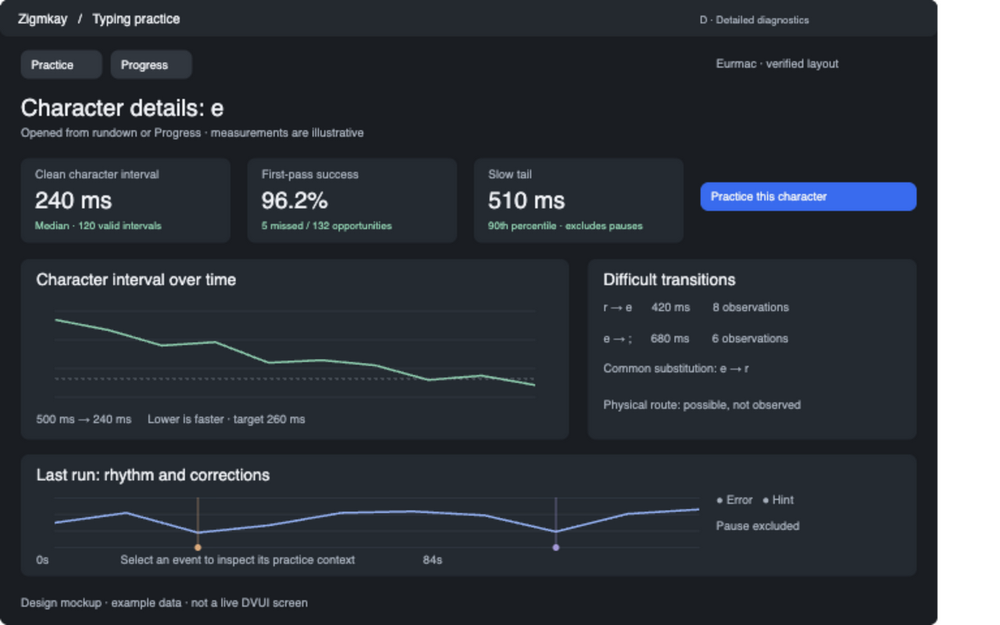

# D — On-demand timing and skill diagnostics

Temporary tracking plan. Remove after implementation and review.

Implement research items 8, 9, 10, 11 and 18 together: selected-character timing, hesitation, run rhythm, transitions and layer/modifier summaries. Keep this view behind More details or character selection. Show quantile units/sample counts and old-run timing unavailability. Keep corrections and excluded events inspectable. Physical coaching requires actual attributable telemetry; possible routes remain labeled as possible.

- [ ] Versioned analysis over A events
- [ ] Character timing/targets and transitions
- [ ] Run rhythm and contextual event selection
- [ ] Modifier/layer breakdowns and evidence provenance
- [ ] Bounds, missing data, native UI and review

Requires A and B/C navigation. See [design](../design/typing-practice-packages.md#package-d-timing-and-skill-diagnostics).
