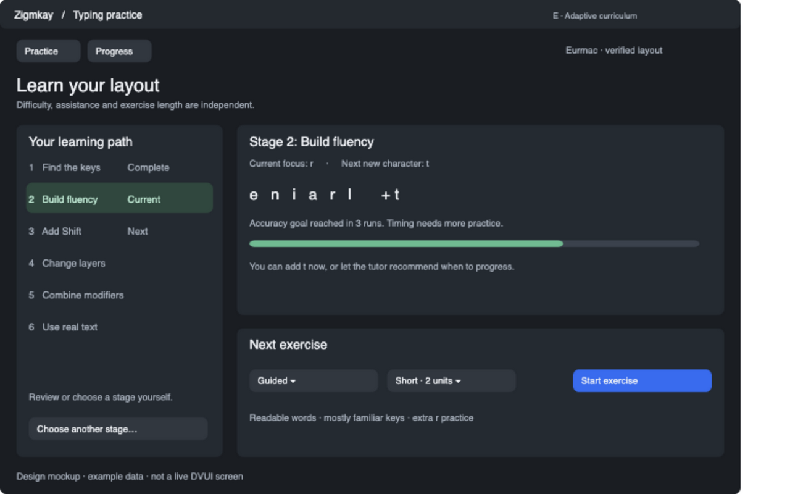

# E — Adaptive alphabet and difficulty

Temporary tracking plan. Remove after implementation and review.

Implement research items 12, 13 and 15 together. Progress through Find keys, Build fluency, Add Shift, Change layers, Combine modifiers and Real text. Preserve independent length/assistance choices. Keep text readable and routes reachable. Persist versioned curriculum/generation context. Introduce one character or modifier family at a time, retain learned content, and explain advancement recommendations. Allow manual progression. Treat proposed mastery thresholds as hypotheses requiring human validation.

- [ ] Versioned curriculum and constrained generation
- [ ] Calibration, repeatable mastery and review hysteresis
- [ ] Stage selection and next-exercise explanation
- [ ] Reachability, reproducibility and assisted/unaided distinctions
- [ ] Human/native acceptance and final review

Requires A's evidence. See [design](../design/typing-practice-packages.md#package-e-adaptive-curriculum-and-difficulty).
