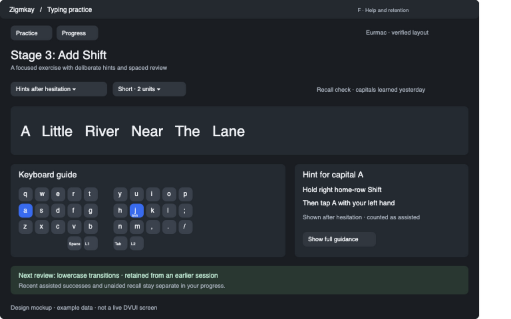

# F — Deliberate hints and retention

Temporary tracking plan. Remove after implementation and review.

Implement research items 14 and 16 together: full/delayed/on-request/hidden help and scheduled recall. Show contextual panels only when needed. Teach proven hold/tap/release sequences; prefer opposite-hand home-row Shift only with supporting metadata. Persist cue exposure and separate assisted practice from unaided recall. Mix retained familiar content with weak/new targets. Explain review recommendations without forcing a schedule.

- [ ] Hint policy and measured cue exposure
- [ ] Contextual hold/layer/modifier instructions
- [ ] Recall/review scheduling and explanation
- [ ] Pause, evidence, accessibility and learner-control acceptance
- [ ] Native/human validation and final review

Requires A and E. See [design](../design/typing-practice-packages.md#package-f-deliberate-help-and-retention).
