# Typing practice

Open **Typing practice** from the editor. Choose English or a retained Zig
lesson, your input source and assistance, then press **Start**. Pause/Resume
keeps the current exercise. **Fresh run** and **New exercise** generate fresh
English text; they do not replay a normal exercise.

**Progress**, **Lessons** and **Review** open focused panels. **More…** contains
Practice data, Hint settings, Challenge seed and Saved history. Panels share
left-aligned headings and cards; smaller windows stack cards and scroll.
See the [native layout comparison](implementation/practice-layout-review.md)
for mockups, before/after screenshots and the clipping audit.

## Text and challenges

English preset and length are independent:

| Preset | Practice |
| --- | --- |
| Words | Lowercase vocabulary, spaces and full stops |
| Mixed case | Sentence capitals, names, acronyms and terms such as IPv6 and mDNS |
| Punctuation | Semicolons, apostrophes, balanced straight quotes, colons, parentheses, modest numbers and other punctuation |

Short, Normal and Long use 2, 5 and 10 sentence units. A unit can contain
more than one sentence. Their respective bounds are 512, 1280 and 2560 ASCII
characters, below the session's 8192-codepoint limit. Generation fails explicitly
rather than returning a truncated word or unmatched quote. The corpus has 893
unique first-party base vocabulary entries; names, acronyms and case variants
are additional material. Zig lessons retain their original text.

Normal English starts from fresh generation input across launches. Vocabulary
and sentence openings vary within runs; immediate repeated openings are rejected
with bounded retries. This does not promise global uniqueness. When proven
physical routes identify both hands, normal Mixed case includes at least one
capital per hand in Short and two per hand in Normal/Long. If that mapping is
unavailable, the tutor reports textual coverage only.

**More… → Challenge seed** opens an optional control. Enable **Challenge v1** and
enter an unsigned 64-bit seed. Friends must match seed, English preset, length,
and generator/corpus/coverage versions (all initially 1). Challenges deliberately
reproduce the same text, independently of time, platform, keyboard layout and
personal history. Normal hand balancing is excluded from challenges. Changes
to this contract require a new version. The result also displays its seed.

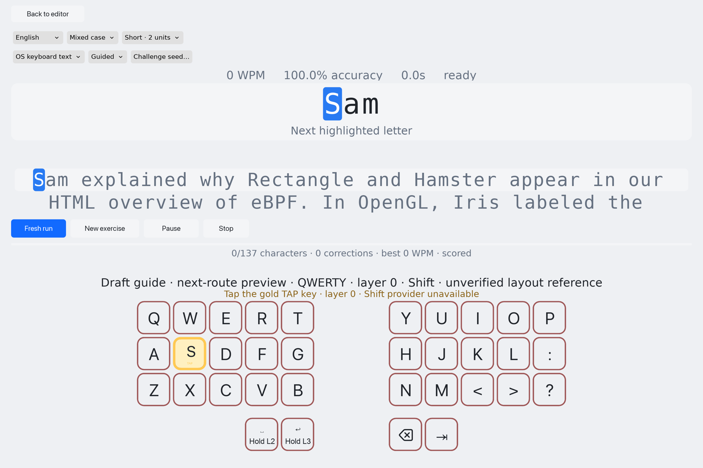

*The implemented tutor, captured natively on macOS using an offline QWERTY
fixture. Screenshot content is exercise data, not a live device recording.*

## Assistance and Shift

**Guided** displays target TAP and necessary HOLD keys. A static draft can
preview the next route and says so. Shift guidance prefers an opposite-hand
home-row modifier from action and physical metadata. Already-held Shift is
accepted. If that provider is absent, the tutor explains its fallback; it never
asks you to hold the target tap itself. Text correctness does not grade which
Shift key you actually used. Unknown translation placeholders, named keys and
arbitrary callback text retain display captions but are never invented typing
routes. Unknown custom hold callbacks are not required as guidance providers.

**Layout only** displays the keyboard without target, HOLD or pressed-key
highlights. Only verified live or simulated processor state changes its actual
layers/modifier captions. A plain draft remains a labeled static reference.
**Hidden** removes the practice keyboard, including a companion window
participating in practice. These choices apply to practice; returning to the
editor restores ordinary companion behavior.

Native OS text does not establish physical key telemetry. Draft text comes
from the prepared real processor, with the existing cancellation and snapshot
guards. Detected layout/input-source changes invalidate a run's comparability and require
a fresh exercise. Loss of verified live state shows an unavailable keyboard.

## Deliberate hints and recall review

Choose **Delayed hints** or **Hints on request** to reduce guidance gradually.
**More… → Hint settings** controls the delay and optional adaptation to matching clean
character timing. Delays exclude pauses and restart for each target. **Show hint**
is available even in Hidden practice. The keyboard stays the same size and position
when hints appear. Cyan marks keys to hold; amber marks the key to tap, with a
compact color legend. Connection details sit quietly at the bottom left.

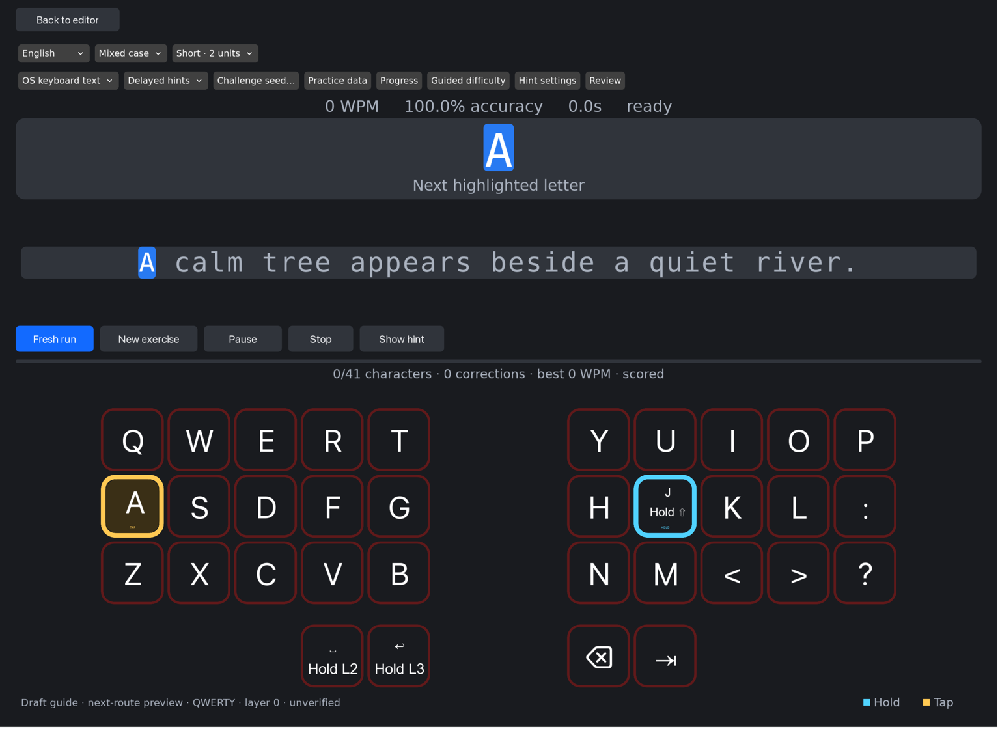

New runs record cue visibility and cued/uncued character opportunities. Visibility
means help was rendered, not that you noticed it. Requested help during hidden
practice stays separate from fully hidden recall evidence. Older runs have
unknown cue evidence; paste, repeat and batch input do not become clean timing.

**Review** offers optional hidden recall lessons with familiar surrounding text.
A qualifying character check needs five clean uncued occurrences, positive
duration and at least 97% uncued first-pass success in a completed hidden run
without revealed help. Suggested intervals grow from 1 to 3, 7 and 14 days.
These are initial policy choices, not proof that you forgot or mastered a key.
You can practice early, show help or ignore the recommendation.

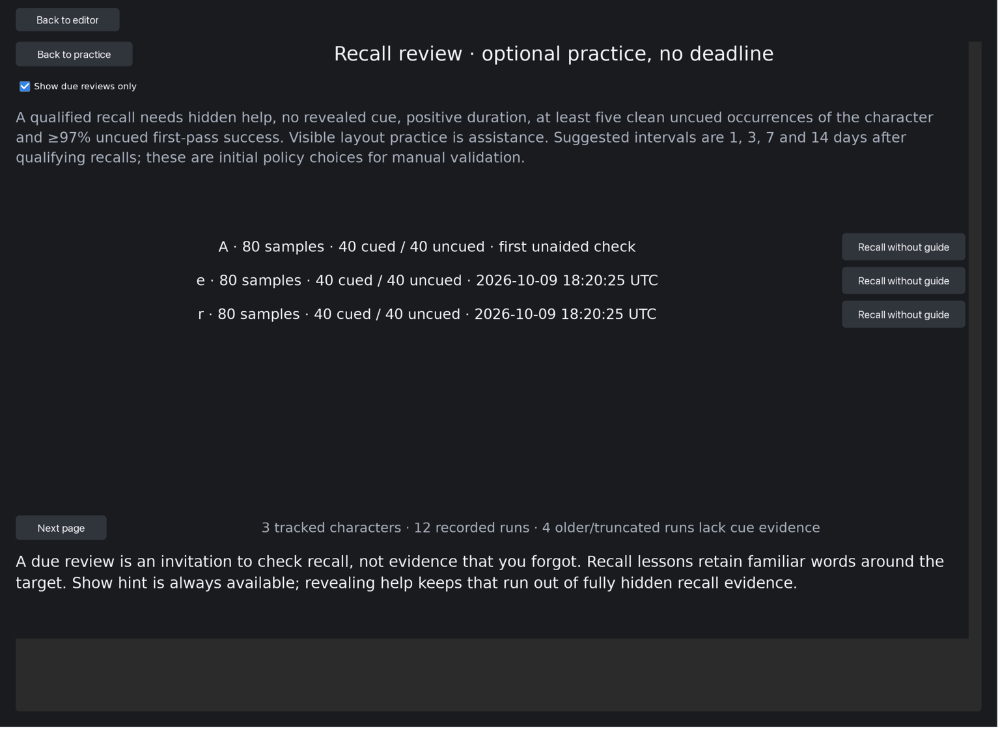

Review keeps layouts, input sources, text families and verified/draft evidence
separate. Small windows scroll the review page; unavailable targets explain why
a matching lesson is needed. [Implementation and review](implementation/practice-help.md)
describe the evidence rules and database migration.

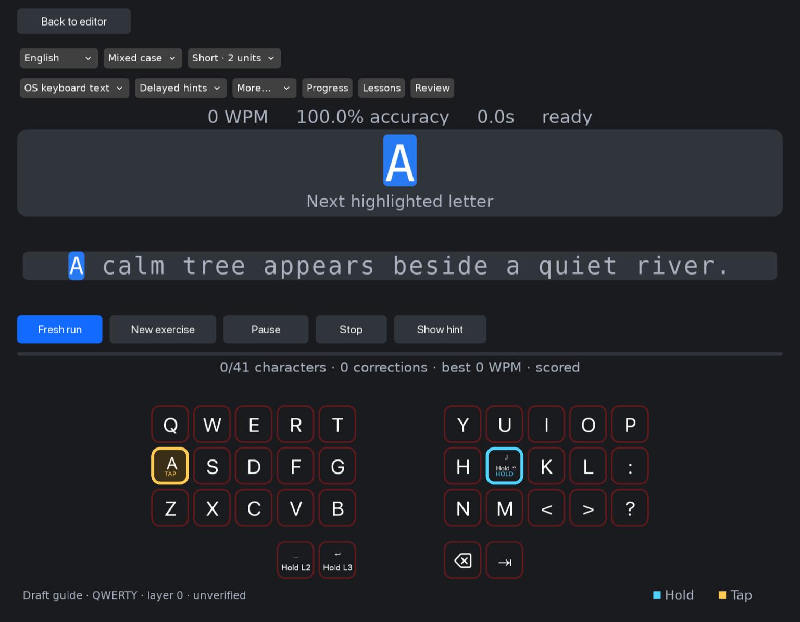

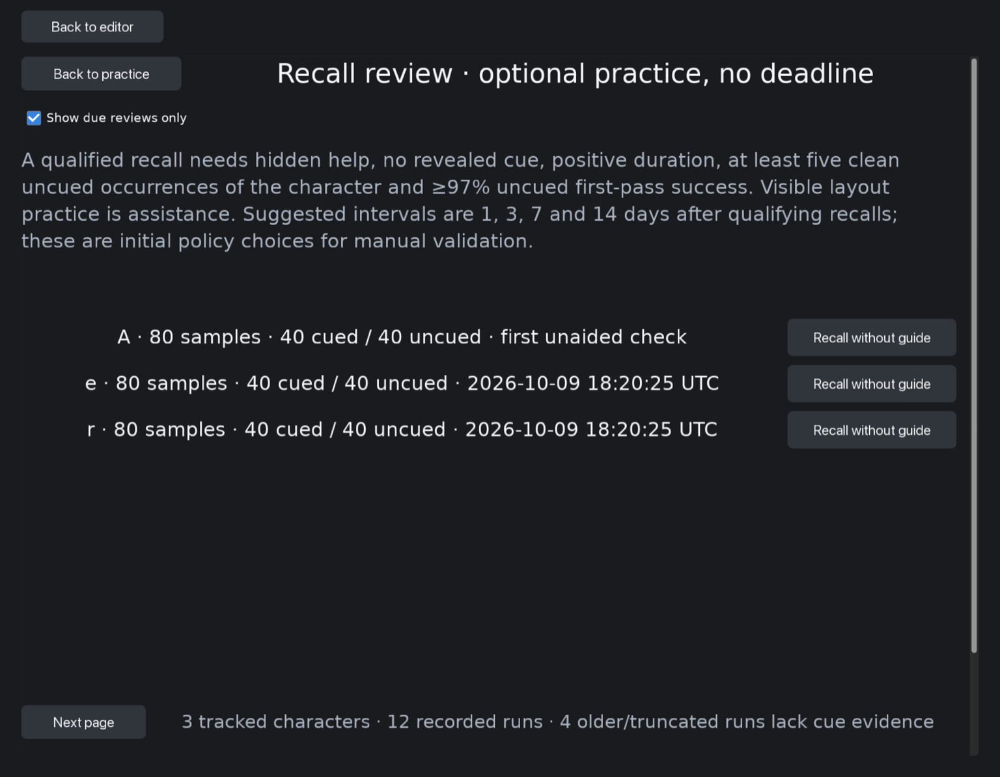

## Guided difficulty

Open **Lessons** to choose a guided lesson without changing exercise length
or assistance. The six stages are Find keys, Build fluency, Add Shift, Change
layers, Combine modifiers, and Real text. Start the selected lesson explicitly;
**Free exercises** returns to the existing unrestricted generator.

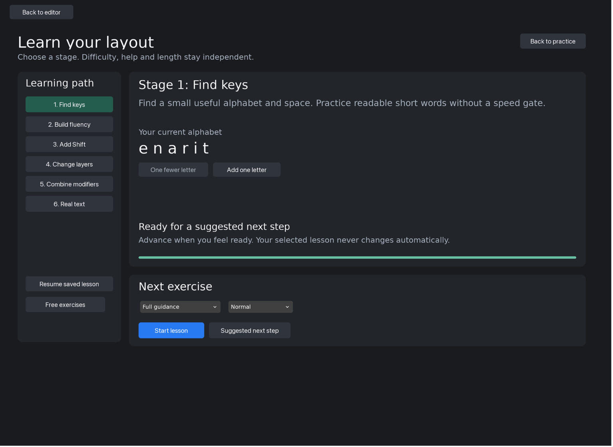

Find keys begins with six reachable base-layer letters in the useful order
`enaritoslcdumpghbyfvkwzxjq`, skipping letters unavailable on that layout. It
uses readable vocabulary words and space, with no speed gate. Build fluency
keeps familiar letters while adding one character at a time. Short, Normal and
Long generate 8, 20 or 40 familiar words in these introductory lessons; later
key-family lessons add one target between every pair of words.

Shift introduces one capital or shifted punctuation output at a time. Layers
selects one output on a chosen layer with a proven hold provider. Modifiers
separates Option/left Alt, AltGr/right Alt and their Shift combinations. The
guide prefers the lesson's requested route for that target. It still cannot
prove that the learner used that physical route: text scoring measures output,
not execution of the hold sequence. Unsupported providers/outputs explain why
a lesson cannot start. Real text uses complete English sentences or the existing
Zig lessons and checks every character's reachability.

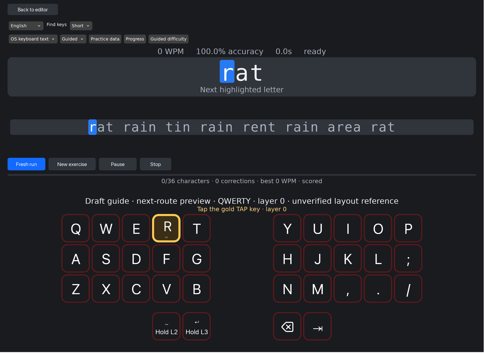

The evidence checklist initially asks for 20 opportunities per target at 97%
first-pass success over at least three completed matching runs. After Find keys,
the newest three matching runs also need at least 97% attempt accuracy, positive
duration, five clean timing intervals and no truncation. These are initial tutor
policy thresholds for human validation, not validated learning science. Timing
calibration establishes repeated clean evidence; it does not impose a universal
WPM target. **Suggested next step** proposes one letter/output/family at a time.
Manual selection remains available, and no poor run automatically demotes a
selected lesson. Guided practice remains separate from hidden-assistance evidence.

Curriculum/generation context is frozen with every run. **Resume saved curriculum**
restores the last scored completed normal lesson for this layout, mapping and
input source, including its length, preset and assistance. Export/import carries
that context between PCs/worktrees. In-progress selections persist after a run
is completed, rather than being written as separate mutable learning state.
Progress titles identify the selected curriculum stage and alphabet. Small
windows scroll to keep stage choices and controls accessible.

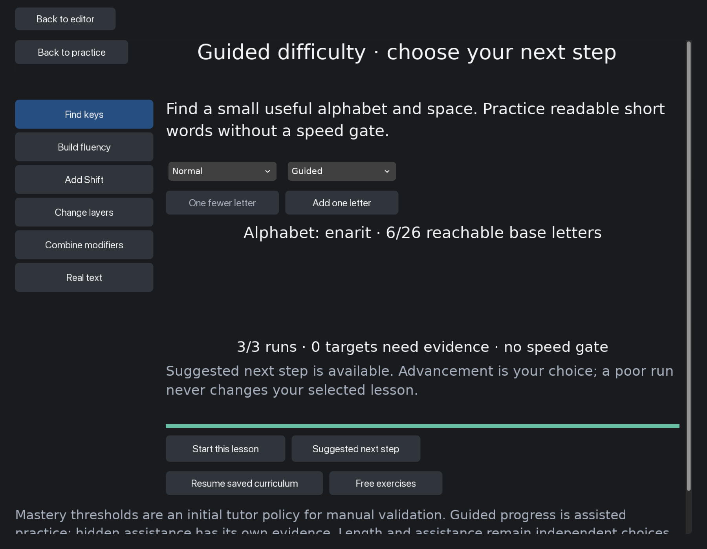

## Progress and daily activity

Open **Progress** for history charts without expanding the immediate rundown.
**Trends** separates speed and attempt accuracy on aligned time axes. Blue marks
are raw measurements; optional green speed/blue accuracy smoothing uses an exponential weight of
0.35 for the new point and never joins gaps longer than 24 hours. Zero-duration
runs do not produce plotted measurements. Single runs still produce a point.
The view uses the newest 60 scored completed runs in the exact comparison cohort;
Today and Last 7 days filter that bounded window. The displayed UTC date range
and sample count stay explicit. Assistance, challenge/drill mode, length, source
and layout remain separate cohorts rather than silently mixed trends.

Recent average is the mean WPM of displayed runs with positive duration.
Accuracy uses a focused range with visible axis limits, so small changes remain
readable without mixing its scale with speed.

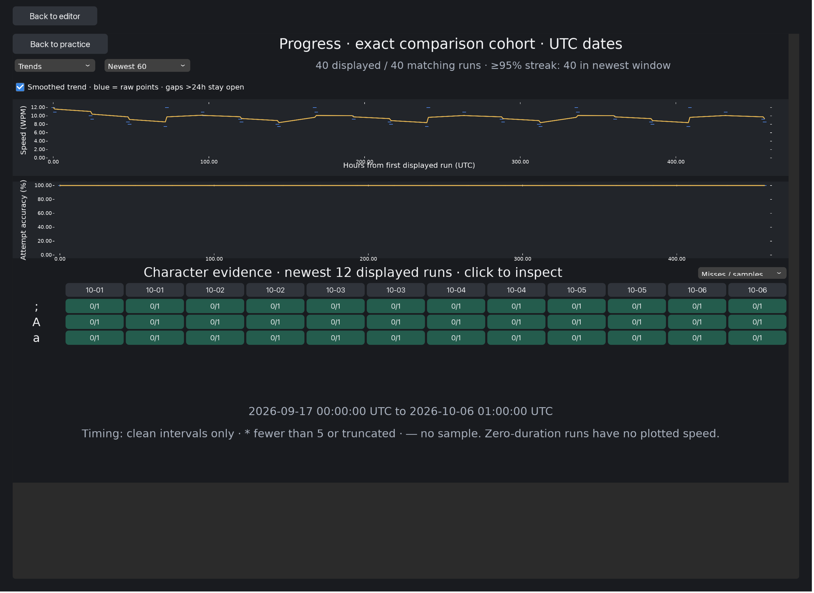

The matrix shows up to the newest 12 displayed runs, fitting fewer columns in a
narrow card, and up to six characters ranked by all-history weakness.
Switch between first-pass success percentages,
exposure, and median clean interval in milliseconds. Timing excludes correction,
batch, paste, repeat, first-input and boundary intervals. An asterisk marks fewer
than five valid intervals or a truncated recording; a dash means no timing
sample, including older count-only runs. These intervals describe text input
events, not physical key hold duration. Click a date to open that saved rundown,
or a cell to open the run with its character selected.

**Activity** shows active practice minutes for the last 28 UTC days, including
matching scored runs older than the plotted window. Choose a voluntary 1-, 3-
or 5-minute goal; blue days have practice, green days meet that goal. The choice
lasts for this editor session. The accuracy streak counts consecutive newest
scored completed runs with positive duration and at least 95% attempt accuracy;
it is explicitly limited to the newest 60, not a claim about all-time records.

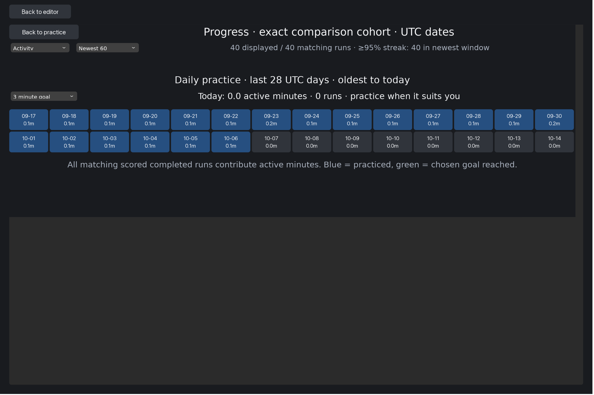

The view scrolls in small windows. Empty histories explain how to start; failed
reads offer Retry. History with rejected records is identified as incomplete.

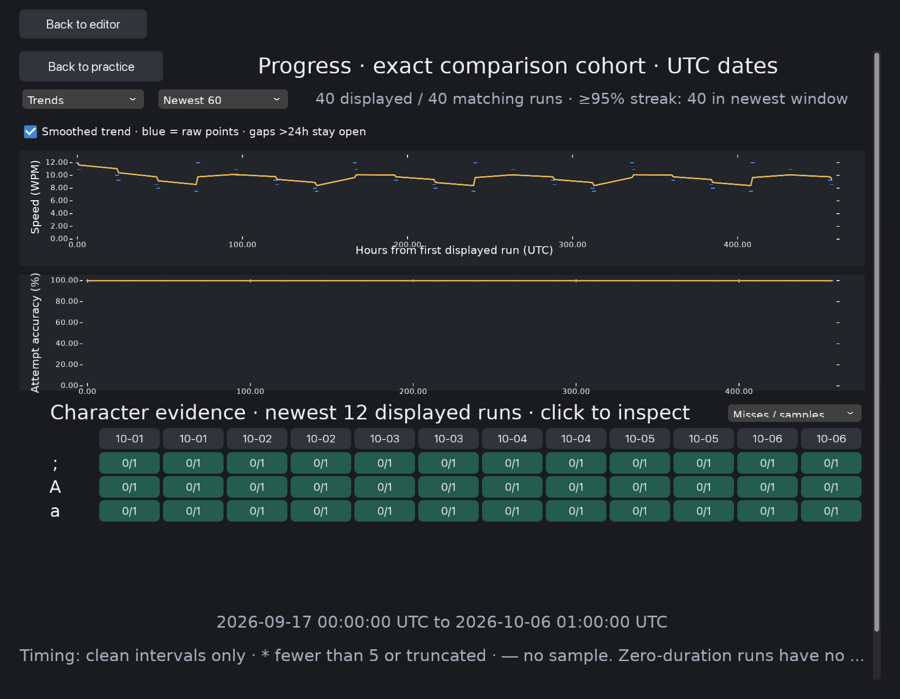

## On-demand timing details

Choose **More details → Timing details** in the rundown, or click a timing
matrix cell in Progress. **Characters** shows the selected character's clean
interval median, p95 slow tail, sample count, first-pass success and matching
run medians over time. The median averages the two middle values for an even
sample; p95 uses the nearest-rank definition. Missing samples show a dash.

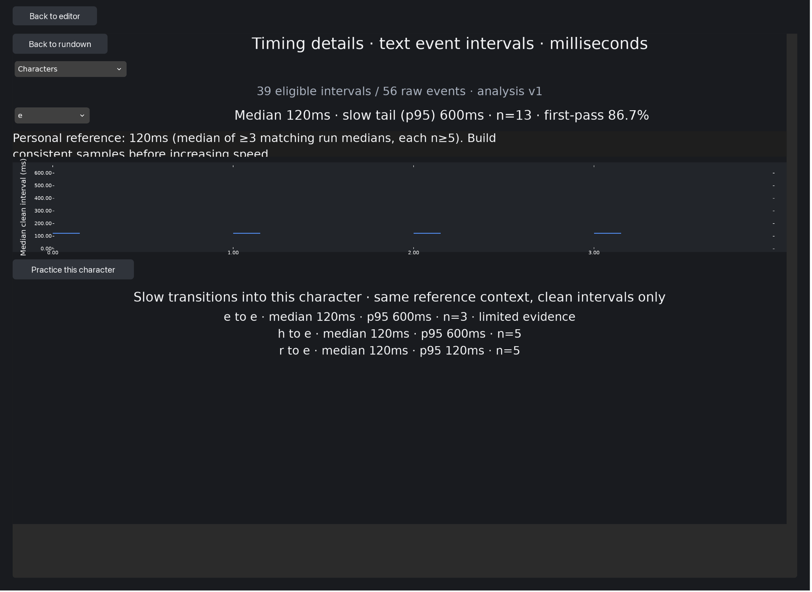

A personal reference needs at least three other matching, nontruncated runs,
each with five valid intervals for that character. It is the median of their
run medians, not a universal speed target. A run median more than 25% above that
reference suggests a careful drill when the current run has at least five
samples. **Practice this character** keeps the current source/layout, assistance,
length and preset; it requires a scored English run with matching settings and
corpus coverage. Transition rows expose slow pairs into the selected character
with median, p95 and sample counts. They describe consecutive reference context;
the character drill does not guarantee a particular bigram.

**Run rhythm / events** shows 64 buckets over active practice time. Blue marks
show mean eligible interval, with separate error, correction, pause and hint
markers. Empty buckets stay empty. The raw event list includes every retained
event, including excluded attempts, in pages of twelve. Select one for its
reference context, typed character, observed clock, elapsed/active time, batch,
assistance and eligibility. Analysis exclusions do not delete observations.

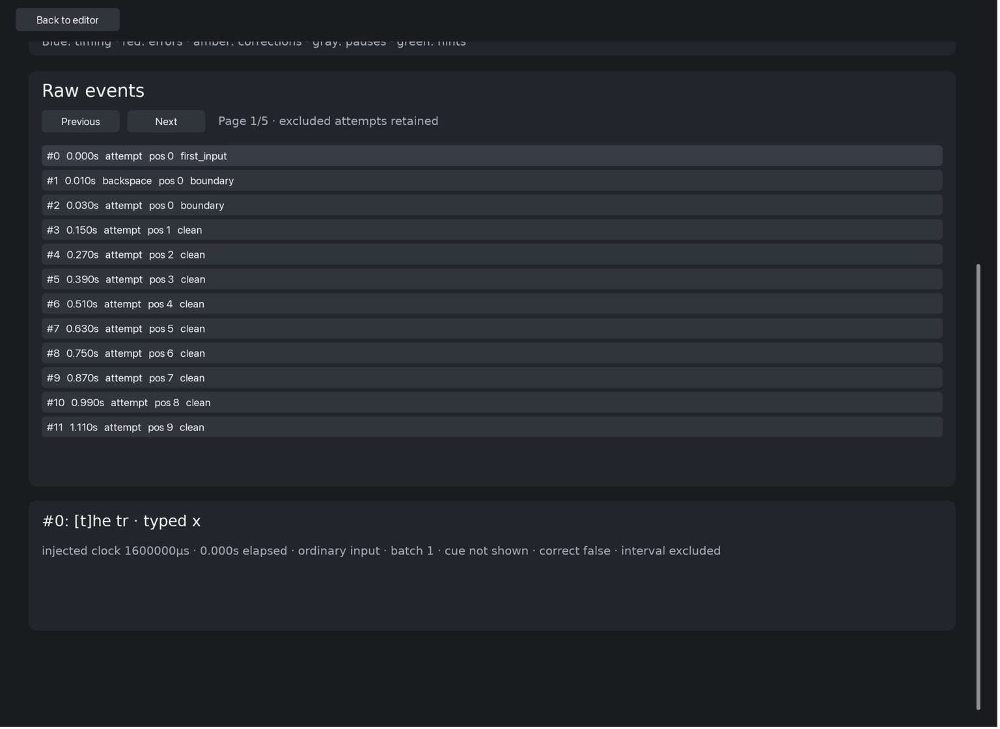

**Skills / provenance** shows clock sources and exclusion counts. Text events
cannot establish which physical route, layer, modifier or finger was used.
Frozen proven routes remain labeled **possible**, and physical performance is
explicitly unavailable. Frame timestamps also remain distinguishable from
native event timestamps. Older count-only histories explain their missing data;
truncated recordings label conclusions incomplete. Details scroll in small
windows and do not record ordinary keyboard input while open.

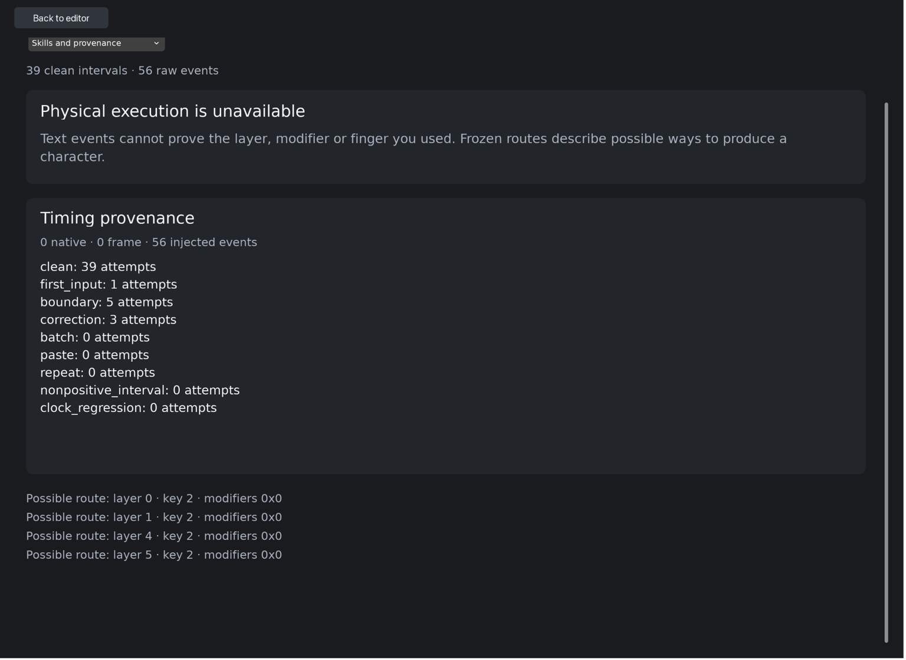

## The layer rundown

Completion replaces the typing view with a keyboard heatmap. Choose **This run**,
**Last 10 runs**, or **All history**, then a layer and modifier variant. Layer
counts come from the captured layout; Shift, left Alt/Option, right Alt/AltGr
and their Shift combinations stay explicit. Unsupported routes remain neutral.
Reviewing results never changes the live keyboard's active layer.

The compact summary separates **attempt accuracy** from **first-pass success**:
the latter counts reference occurrences that never received a wrong attempt.
A matching recent baseline excludes the displayed run itself; absent elapsed
time or comparable history shows an explicit no-baseline message. The next-step
sentence recommends weak-character practice only with sufficient evidence.

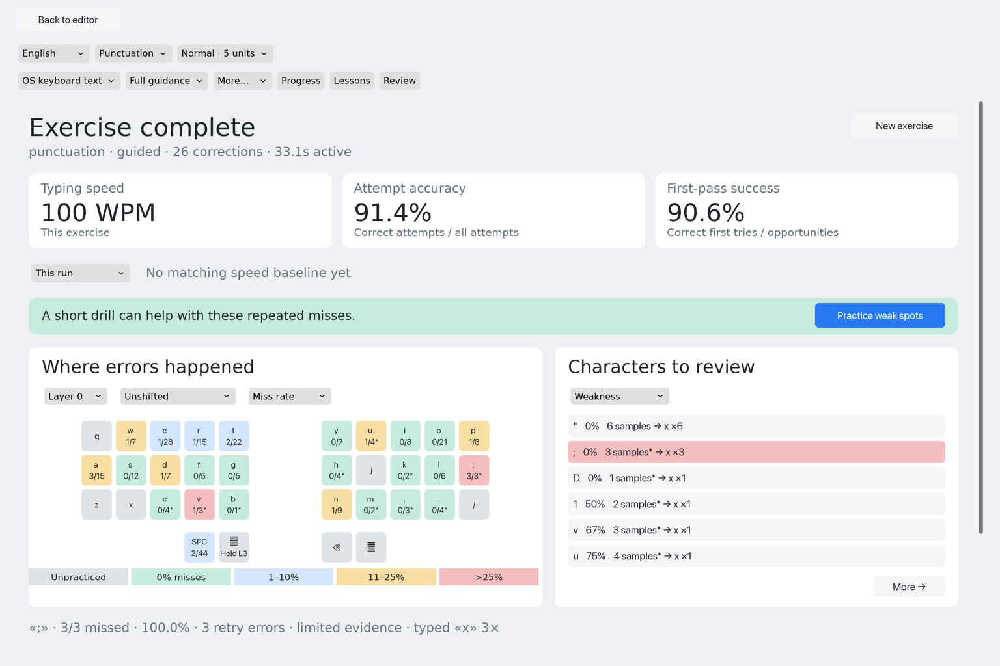

Switch **Miss rate / Exposure** to distinguish errors from practice volume.
Character rows show first-pass success, opportunity count and the most common
observed substitution. Sort by weakness, character or exposure. Select a row
to link its proven keyboard route and show exact confusion counts. **Practice
weak spots** uses a selected repeated confusion pair when its expected character
has at least five opportunities and two missed occurrences and the pair appeared
at least twice. Unsupported text targets produce a corpus/preset explanation.
Otherwise it uses the existing broad weak-character recommendation.

**More details** reveals frozen routes, generation context and Clear history.
Small windows stack the character cells beneath the keyboard. Sample counts and
asterisks describe limited evidence; they are not statistical confidence claims.
SPC, RET and TAB are compact labels for Space, Enter and Tab.

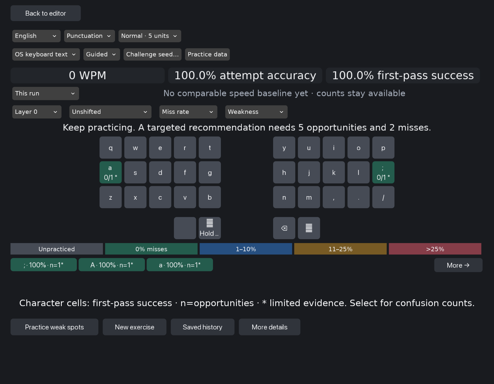


*This run, with expected-character misses projected onto proven fixture routes.
Gray means unpracticed; green means practiced with zero misses. Numbers remain
available independently of color.*

A key's `3/12` means three distinct troublesome occurrences in twelve reference
opportunities, or 25%. Repeated wrong retries at the same position remain one
miss. Backspacing a previously correct character and re-entering it incorrectly
also marks that occurrence missed. Retry errors and observed substitutions are
separate counts. Case and symbols remain distinct: `a`/`A`, `;`/`:`, and
apostrophe/quotation are never merged. Unicode positions are codepoints, and
CR/LF input and references normalize to a newline. Outside-reference errors are
counted separately.

Accuracy remains correct attempts divided by all attempts. WPM uses matched
characters and active time, excluding pauses. The headline describes the selected
run; the heatmap uses the selected scope. History sums misses/opportunities,
not percentages: `1/2` plus `1/18` becomes `2/20`, or 10%. A pasted preview is
unscored and excluded from scored bests and default history analysis.

The legend distinguishes unpracticed, 0%, 1–10%, 11–25%, and greater than 25%.
An asterisk marks fewer than five opportunities. Select a key or a character
in the character list for counts, miss rate, retries and observed substitutions;
More details adds proven routes. Selecting a character opens its first route's view. **More →**
pages the character strip. Up to four distinct physical routes and 256 observed
substitution pairs are retained per run; truncation is identified. When a route
or matching geometry is unavailable, the character list still works.

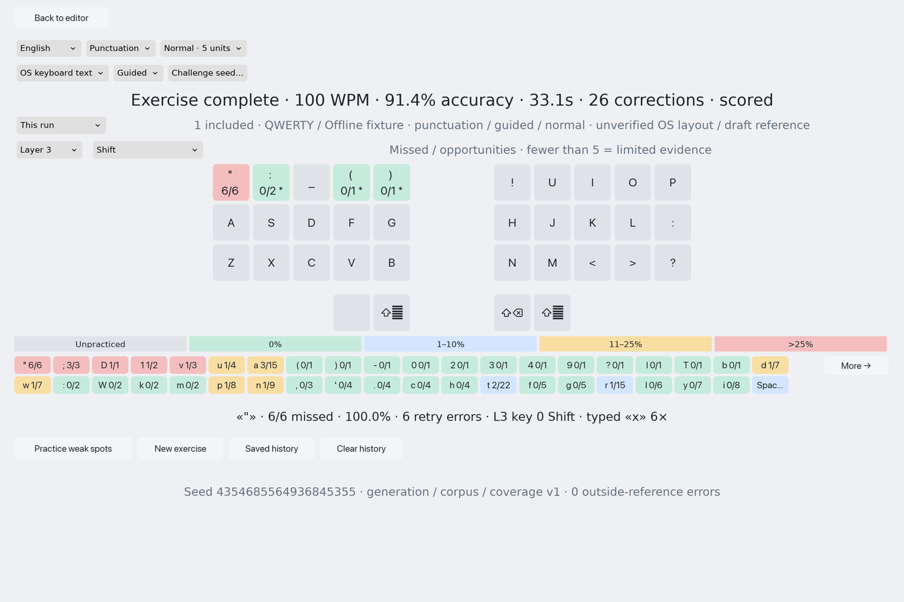

*Quotation practice, kept distinct from apostrophes and unshifted characters.*

## History and weak spots

Comparison requires matching board/keymap behavior, translated input-source
mapping, OS/draft source, exercise family, preset/lesson, length, assistance,
normal/challenge/drill mode and compatibility versions. Profile names and source
names are displayed; renaming or moving a project is not a behavior change.
An unverified OS layout or draft reference is labeled explicitly. Selecting an
editor project does not certify the keyboard producing native text.

Last 10 uses the newest ten eligible scored runs, including the just-completed
run; it shows the actual count if fewer exist. All history includes every retained
eligible run. **Saved history** is also available before starting a new exercise,
so a relaunch does not require completing another run. The list has ten-run pages
and an **Older runs →** action. Opening it refreshes the filesystem snapshot.
This run remains the frozen completed result. Corrupt or unsupported files are
preserved and reported; affected history scopes are explicitly incomplete.

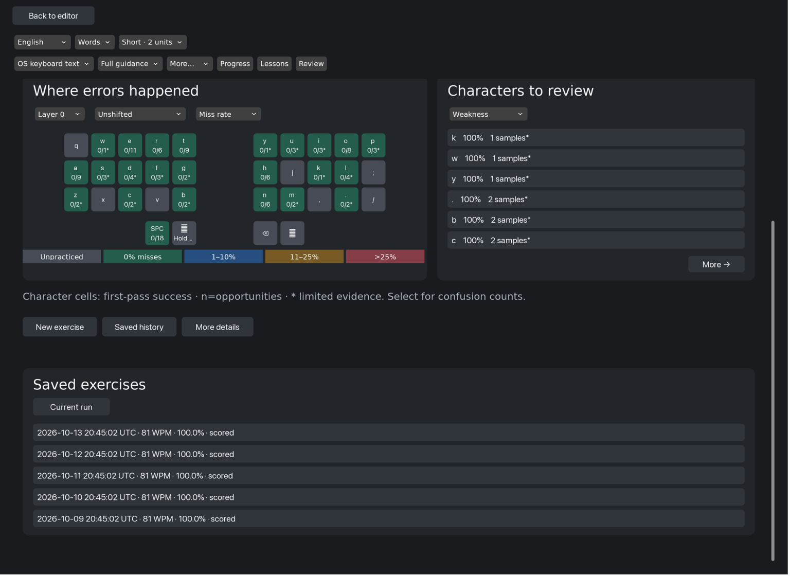

*Last 10 compared with This run above. The native screenshot uses deterministic
fixture aggregates, not personal saved history.*

**Practice weak spots** freezes the selected analysis and chooses supported
characters using at least five opportunities and two missed occurrences,
ranked by `(misses + 1) / (opportunities + 4)`. It selects up to five targets,
then fresh candidates from the same corpus. Ordinary filler keeps the passage
readable. The drill displays and saves its focus, with separate score cohorts.
There is no claim of finger, layer or modifier diagnosis from OS text.

Sparse evidence offers a fresh normal exercise. If a target needs capitals or
punctuation, choose the harder preset explicitly and request the drill again.
Insufficient corpus coverage is reported rather than changing the preset or
inventing a route. Candidate selection is implemented; a later weighted
probability generator is outside this feature. User trials are still needed to
judge learning outcomes.

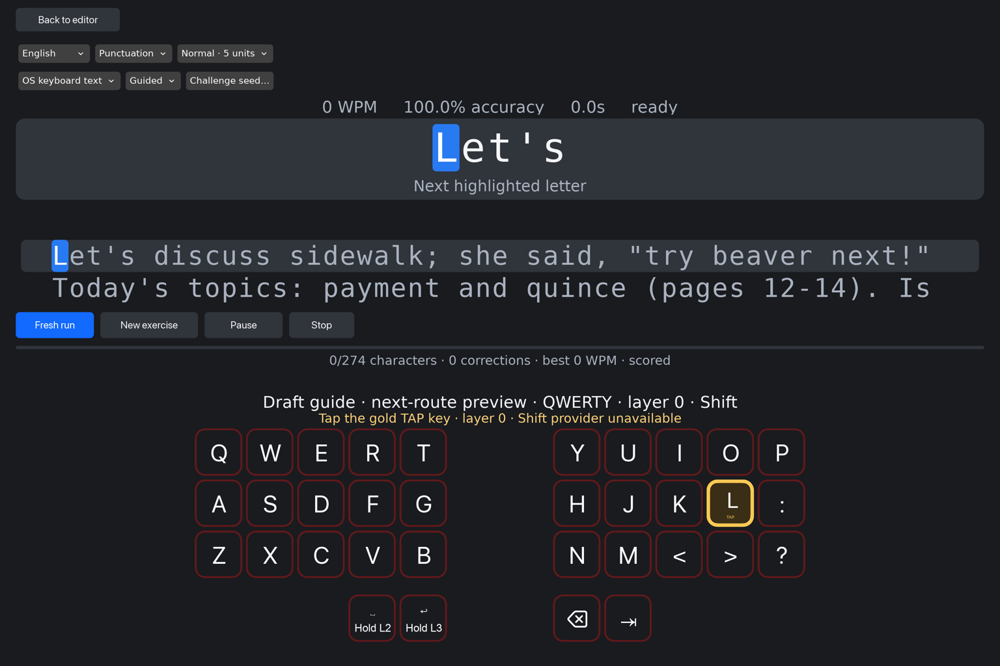

*An offline candidate-selection drill with explicit focus characters.*

## Local data and recovery

Completed sessions save automatically outside projects:

| Platform | Practice directory |
| --- | --- |
| macOS | `~/Library/Application Support/zigmkay/data/typing-practice/` |
| Windows | `%LOCALAPPDATA%/zigmkay/data/typing-practice/` |
| Linux | `$XDG_DATA_HOME/zigmkay/typing-practice/`, or `~/.local/share/zigmkay/typing-practice/` |

History now lives in `practice.sqlite3` inside that directory. Runs and their
timing events are committed together in a transaction. Stable random run IDs
make retries and imports idempotent. Separate instances share the database with
bounded busy retries. A background worker performs storage work outside input
and rendering. Failed writes retain the in-memory result and a pending queue
(up to sixteen runs); **Retry** attempts the same ID. If the queue fills, the
newest rundown is retained and fresh starts wait for Retry or deliberate
clearing. Shutdown drains queued writes where storage remains available.

Existing version-1 ZON histories are imported automatically without changing
their original counts or deleting the files. Import receipts prevent those
retained files from resurrecting cleared history. Older runs have no timing
samples; total duration is never used to invent them. Unknown or corrupt legacy
records remain untouched and are reported.

### Timing datapoints

New completed runs and explicitly stopped exercises retain the generated
reference and individual exercise attempts, backspaces, pauses/resumes, focus
boundaries and shown guidance. Stopped exercises are labeled and excluded from
scored history. Data includes expected/attempted Unicode characters, active and
elapsed microseconds, input batches, scoring context and timing eligibility.
It records only input routed to an active practice exercise, not background or
free typing. It does not infer physical key/finger/Shift choices from OS text.

Native text events retain their mapped native timestamps. Frame-level fallback
and draft-runner delivery timestamps are marked separately. First input,
corrections, explicit pauses, pasted/batched commits, repeats and nonpositive
intervals remain inspectable without being treated as ordinary clean motor
intervals. CRLF is normalized consistently with scoring. A per-run limit of
32,768 events bounds memory; a retained prefix, dropped count and truncation
flag make incomplete timing explicit. Timing is collected now for later
analysis; the tutor does not add timing charts to the rundown yet.

### Export and import

Open **More… → Practice data** in the tutor. Enter an absolute database filename and
choose **Export database** to create a standalone snapshot, including committed
data still in SQLite's write-ahead log. The export destination must not already
exist. Export/import wait until pending saves finish.

Copy that exported file to another PC or worktree, open **Practice data** there,
enter its path and choose **Import database**. Import merges all valid runs;
matching run IDs are kept once. Different data under the same ID rejects the
whole import, leaving existing runs intact. Unknown database versions and
malformed payloads are rejected. Layout/source comparison rules still apply to
imported history. Worktrees normally share the same user-data directory, so
importing the same export again is harmless.

Use the app's export action rather than copying the live SQLite file alone:
active databases can have accompanying WAL files. SQLite 3.54.0 is pinned and
built from its verified source package; application storage logic remains in Zig.

The current schema remains 3. Upgrading schemas 1 or 2 creates a validated,
standalone online backup in persistent `typing-practice/backups` before any
migration. Backups are retained. If backup creation fails, the upgrade stops and
keeps the original database. See [history rollback instructions](preview-releases.md#history-upgrades-and-rollback)
before restoring an older snapshot; all instances must be closed, and the complete
current history directory must first be archived, including WAL/SHM files.

Tests and native screenshots use owned caches. Saving a result never rewrites
a project. **Clear history** asks for confirmation and removes validated database
runs only, preserving projects/preferences and unknown
or future records. A completed in-memory This run remains viewable after clearing.
Other instances can still publish new runs while clearing occurs.

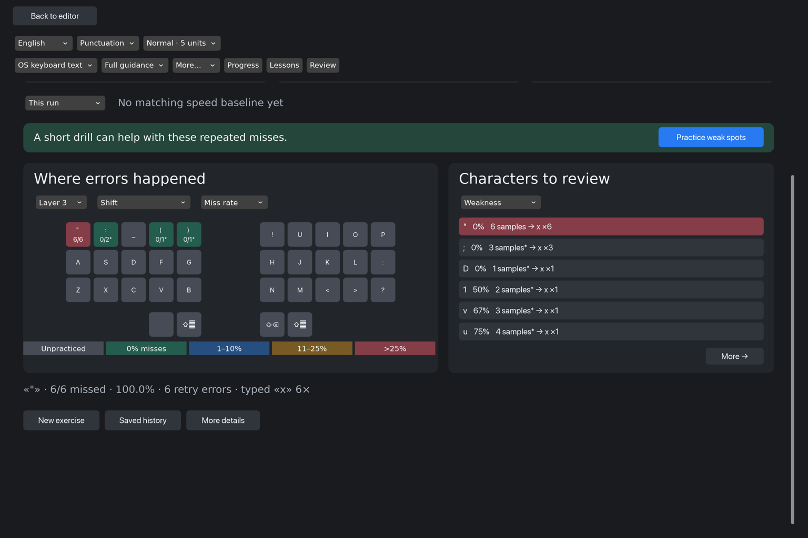

## Test status and morning review

Local evidence covers macOS arm64 storage create/save/reopen, background queues,
failed writes, independent writers, Unicode paths, corruption/future preservation,
core generation/statistics tests and offline GUI fixtures. Native screenshots
cover light/dark and normal/small windows on macOS. The native generation, metrics, storage, background-runtime and path-policy CI
lanes passed on macOS, Windows and Linux at the published review checkpoint. Native GUI/input-source acceptance on those platforms and exploratory
human typing trials remain separate. Cross-compilation is not native acceptance.

Use exactly Zig 0.17.0:

```sh
zig build test-desktop-core test-app-paths
zig build check test -j4 --test-timeout 45s
```

With the prepared desktop source options described in the repository README,
run `test-desktop-practice test-desktop-rundown test-desktop-launch
 test-desktop-companion test-desktop-source-refresh`. `mise editor:test` includes
these offline lanes when its prepared source paths are available.

For a morning product check, open the tutor, try all three presets at different
lengths, pause/resume, reproduce a challenge, compare result scopes, select a
symbol route, request a drill, restart the app and open saved history. Switch
assistance and confirm Layout only has no predictive/pressed highlights. Check
that the editor remains clean. Normal startup monitors keyboards as already
authorized; none of the offline checks accesses devices or flashes firmware.

Capture provenance and remaining acceptance gates are in the
[implementation evidence](implementation/typing-practice.md).
